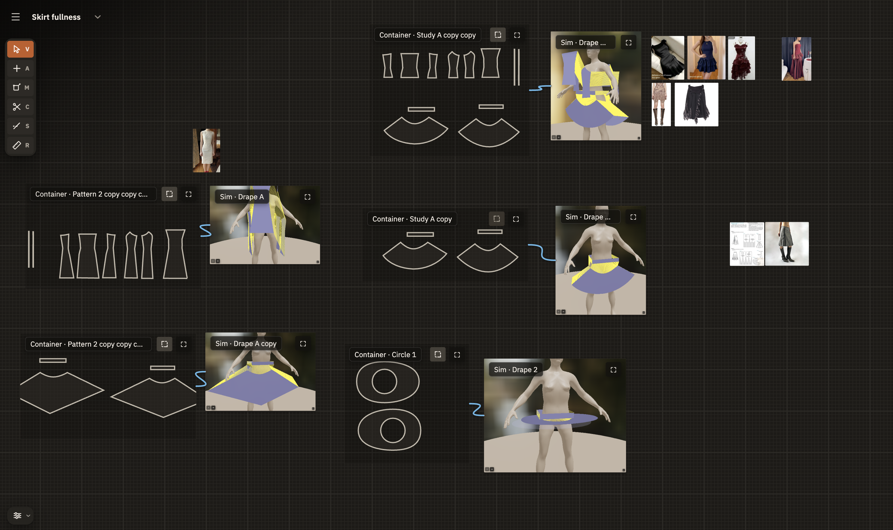
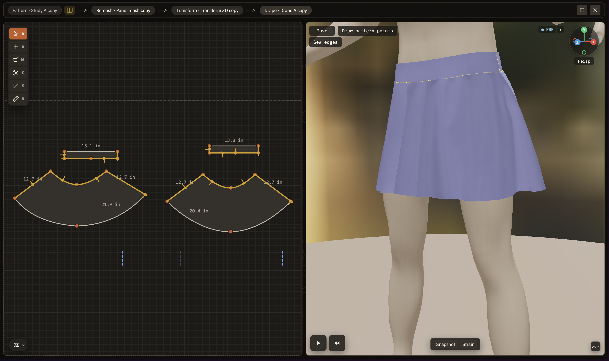

### INTRO

HyperPattern aspires to be an accessible-ish, open-source tool for drafting and simulating draping for one of one garmets. So think making clothes for yourself, costumes, DIY, weird art projects, etc rather than producing a design spec for mass production (as you can already do pretty well with Fabra). I also like procedural art and design and want to support that direction of work by eventually bringing some of what I saw graphics software do in the 2010's for procedural 3d design in motion graphics (Cinema4d, Houdini) to garmet design. 

I'm also interested in it having more of a viewer-oriented mode for embedding in online museum catalogs, etc (like the V&A) to better understand old clothing patterns and garmets, as well as easily copy pieces of them into your own work. I love seeing people recreate old clothes in MD/CLO.

The draping part of this needs a very fast, browser-compatible GPU cloth sim, which is pretty niche and usually not free. Fortunately, someone has written an open source one ([Velvet](https://github.com/vitalight/Velvet)) in C++/CUDA, and Deepseek was able to port it to WebGPU. There is also a CPU based engine as a fallback for driver issues but it is too slow for most tasks and will likely get dropped at some point.

If you are interested in maintaining the GPU engine as its own project, please get in touch.

### GETTING UP AND RUNNING

Right now this is designed to run locally and store data in the browser cache. If you aren't a developer, the easiest way to run this is: 
1. install Node.js on your computer
2. Clone (download) the repo and unzip it to some folder in your apps or documents
3. Open your terminal
4. Navigate to the folder (usually "cd [folder]") you unzipped or cloned the repo to
5. Type "npm run dev" and then hit enter
6. Open a browser and type "localhost:5173" into the URL bar

If you aren't used to doing this, I strongly recommend having ChatGPT/Claude etc help you along.

Obviously, it could be easier and there are some hard limits on file storage, but hey - no signup, no $40/month like CLO.. sacrifices must be made. Someday I'll work out deploying it on Vercel and a better way to store the local pattern/asset database.

### HOW IT WORKS

Hyperpattern isn't so opinionated about workflow, but it assumes something like:

Gather references
Do small studies (e.g. circle skirt? godets? princess seam or sloper block bodice?)
- Draw one piece in 2d -> drape in 3d
Do larger full garmet studies
- Assemble all pattern pieces -> drape in 3d
Project the pattern directly from the app on fabric to cut or export
Cut a muslin for the parts where fit really matters

It's trying to help you work quickly, intuitively, iteratively and accurately from inspiration to cuttable pattern or interesting sim/mesh. It looks and feels a lot like Figma so that the earlier parts of the process can happen more quickly, as they would in a real studio, where you have all kinds of little studies and drafts laying around.

Like MD/CLO, the idea is that the 2d pattern and and 3d drape are really closely linked, so that you can iterate quickly on a pattern with an avatar that is sized to the measurements of whoever it's for and work the fit out decently well. This is great for learning pattern basics and for working out more complicated patterns (lots of panels, gathering etc) before cutting real fabric to get the final fit right. After using these tools to learn pattern making basics, I really can't imagine learning all that without them.

Keep in mind the sim is not 100% accurate, although I think it's good enough to figure out quite a bit. HyperPattern does ruffles and gathering pretty well, and handles a little bit of layering OK enough. Once you start attaching seams to seams, freezing the underlying pieces can help a lot in helping you pretty closely model the final look without the sim going crazy.

### FUTURE FEATURES

The component system is very basic now but will be like an atomic design approach to creating what are called digital assets in Houdini, components in React, or their ancient ancestors: pattern blocks. Basically, a dart will be a component, a type of collar can be a component, and they get referenced into bodice block components or skirts or whatever, which live in your local component library and can be shared. Measurements are already set up as project variable sets indexed by "person" (you, your friend, s/m/l, 4/6/8/10 etc) and can get referenced in to these as you would expect.

At some point, I hope to have time to build out a full modifier system for doing all the cool procedural design things but in a slightly more friendly way, like Mograph in Cinema4d or maybe even some of the SOP/VOPs in Houdini. Think noise displacement, voroni cuts etc, subdivision, iterative whatever, image maps, etc.. but in terms of your underlying pattern and measurements, not just in terms of a mesh. Haven't quite gotten there yet.

